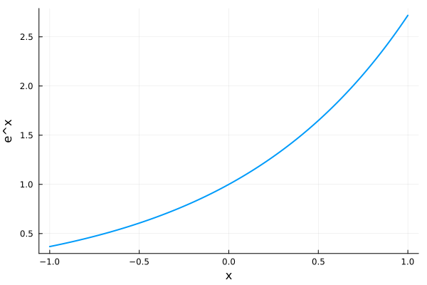

## **Title**: \<Title Content\>

**Authors:** \<Author Content\>

**Affiliations:** \<Affiliations Content\>

**Acknowledgments:** \<Acknowledgments Content\>

**Date:** 2026/10/18

## **Table of Contents**

- [\<Section Title 1\>](#chapter-section-title-1)
- [`<Section Title 2>`](#chapter-section-title-2)

## \<Section Title 1\>

### \<Frame Title 1\>

- **\<Frame Content 1\>**

  - \<Nested Frame Content 1\>

**Definition** (\<Definition Title 1\>)**.** \<Definition Statement 1\>

**Theorem** (\<Theorem Title 1\>)**.** \<Theorem Statement 1\>

<strong>Figure 1</strong> (&lt;Figure Title 1&gt;)<strong>.</strong> &lt;Figure Caption 1&gt;

### \<Frame Title 2\>

- *\<Frame Content 2a\>*

  $$
  \begin{aligned}
                      f(x) = x^2
  \end{aligned}
  $$

  \<Frame Content 2b\>

  
  $$
  \begin{align*}
  f(x) = x^3 \tag{<Equation Title 2>}
  \end{align*}
  $$

  \<Frame Content 2c\>

### \<Frame Title 3\>

- Test Citation: \<Text\>1

- Test Citations: \<Text\>1,2,3,4,5,6,7,8,9,10,11,12

<small style="display: block; font-size: 75%; line-height: 1.35; padding-left: 1.8em; text-indent: -1.8em;">1(Journal Paper) J. A. Smith and J. Brown, <em>A journal paper with a page range</em>, J. Test., 2 (2001), pp. 1–10.</small>

<small style="display: block; font-size: 75%; line-height: 1.35; padding-left: 1.8em; text-indent: -1.8em;">2(Journal Paper) J. A. Smith and J. Brown, <em>A journal paper with an article number</em>, J. Test., 3 (2002), 031505 (12 pages).</small>

<small style="display: block; font-size: 75%; line-height: 1.35; padding-left: 1.8em; text-indent: -1.8em;">3(Journal Paper) J. A. Smith and J. Brown, <em>A single-page journal paper</em>, J. Test., 4 (2003), p. 7.</small>

<small style="display: block; font-size: 75%; line-height: 1.35; padding-left: 1.8em; text-indent: -1.8em;">4(Journal Paper) J. A. Smith and J. Brown, <em>A journal paper with an abbreviated journal name</em>, J. Test., 8 (2004), A12.</small>

<small style="display: block; font-size: 75%; line-height: 1.35; padding-left: 1.8em; text-indent: -1.8em;">5(Journal Paper) J. A. Smith and J. Brown, <em>A journal paper in press</em>, J. Test., to appear.</small>

<small style="display: block; font-size: 75%; line-height: 1.35; padding-left: 1.8em; text-indent: -1.8em;">6(Journal Paper) J. A. Smith and J. Brown, <em>A one-page journal paper with an article number</em>, J. Test., 3 (2006), 031505 (1 page).</small>

<small style="display: block; font-size: 75%; line-height: 1.35; padding-left: 1.8em; text-indent: -1.8em;">7(Journal Paper) J. A. Smith and J. Brown, <em>A published journal paper</em>, J. Test., 2 (2007), pp. 1–10.</small>

<small style="display: block; font-size: 75%; line-height: 1.35; padding-left: 1.8em; text-indent: -1.8em;">8(Preprint) J. A. Smith and J. Brown, <em>An Institutional Preprint</em>, preprint TR-01, Example University, Boston, 2008.</small>

<small style="display: block; font-size: 75%; line-height: 1.35; padding-left: 1.8em; text-indent: -1.8em;">9(Preprint) J. A. Smith and J. Brown, <em>An Online Preprint</em>, preprint, <a href="https://arxiv.org/abs/0000.00000">https://arxiv.org/abs/0000.00000</a>, 2009.</small>

<small style="display: block; font-size: 75%; line-height: 1.35; padding-left: 1.8em; text-indent: -1.8em;">10(Preprint) J. A. Smith and J. Brown, <em>A Manuscript</em>, manuscript, 2010.</small>

<small style="display: block; font-size: 75%; line-height: 1.35; padding-left: 1.8em; text-indent: -1.8em;">11(Preprint) J. A. Smith and J. Brown, <em>An Online Preprint with an Access Date</em>, preprint, <a href="https://example.org/preprint_v1">https://example.org/preprint_v1</a> (accessed 3 Feb. 2025), 2011.</small>

<small style="display: block; font-size: 75%; line-height: 1.35; padding-left: 1.8em; text-indent: -1.8em;">12(Preprint) J. A. Smith and J. Brown, <em>A Social Science Research Network Preprint</em>, preprint, SSRN: 0000000, 2012.</small>

### \<Frame Title 4\>

- Test Citations: \<Text\>1,2,3,4,5,6,7,8,9

<small style="display: block; font-size: 75%; line-height: 1.35; padding-left: 1.8em; text-indent: -1.8em;">1(Book) J. Smith and J. Brown, eds., <em>An Edited Book</em>, 2nd ed., Test Ser. 5, SIAM, Philadelphia, 2013.</small>

<small style="display: block; font-size: 75%; line-height: 1.35; padding-left: 1.8em; text-indent: -1.8em;">2(Book) J. A. Smith and J. Brown, <em>A Book Title</em>, SIAM, Philadelphia, 2014.</small>

<small style="display: block; font-size: 75%; line-height: 1.35; padding-left: 1.8em; text-indent: -1.8em;">3(Book) J. A. Smith and J. Brown, <em>A Book with an Editor</em>, J. Editor, ed., SIAM, Philadelphia, 2015.</small>

<small style="display: block; font-size: 75%; line-height: 1.35; padding-left: 1.8em; text-indent: -1.8em;">4(Thesis) J. A. Smith and J. Brown, <em>A Thesis Title</em>, PhD thesis, Example University, Boston, 2016.</small>

<small style="display: block; font-size: 75%; line-height: 1.35; padding-left: 1.8em; text-indent: -1.8em;">5(Conference Paper) J. A. Smith and J. Brown, <em>A conference paper with a publisher</em>, in Proceedings of a Conference, SIAM, 2017.</small>

<small style="display: block; font-size: 75%; line-height: 1.35; padding-left: 1.8em; text-indent: -1.8em;">6(Conference Paper) J. A. Smith and J. Brown, <em>A conference paper with a sponsoring organization</em>, in Proceedings of Another Conference, Paris, 2018, Example Society, pp. 10–20.</small>

<small style="display: block; font-size: 75%; line-height: 1.35; padding-left: 1.8em; text-indent: -1.8em;">7(Conference Paper) J. A. Smith and J. Brown, <em>A paper in a proceedings book</em>, in Collected Conference Papers, Test Ser. 6, J. Editor, ed., SIAM, Philadelphia, 2019, pp. 21–30.</small>

<small style="display: block; font-size: 75%; line-height: 1.35; padding-left: 1.8em; text-indent: -1.8em;">8(Conference Paper) J. A. Smith and J. Brown, <em>A paper in journal proceedings</em>, J. Conf. Test., 7 (2020), pp. 31–40.</small>

<small style="display: block; font-size: 75%; line-height: 1.35; padding-left: 1.8em; text-indent: -1.8em;">9(Conference Paper) J. A. Smith and J. Brown, <em>A paper in an edited proceedings series</em>, in Conference with Editors, J. Editor and J. Editor, eds., Conf. Ser. 8, Example Society, SIAM, 2021.</small>

## `<Section Title 2>`

### \<Frame Title 5\>

- **\<Frame Content 4\>**

  - \<Nested Frame Content 4\>

**Definition** (\<Definition Title 4\>)**.** \<Definition Statement 4\>

**Theorem** (\<Theorem Title 4\>)**.** \<Theorem Statement 4\>

<strong>Figure 2</strong> (&lt;Figure Title 4&gt;)<strong>.</strong> &lt;Figure Caption 4&gt;

### \<Frame Title 6\>

- *\<Frame Content 5a\>*

  $$
  \begin{aligned}
                      f(x) = x^2
  \end{aligned}
  $$

  \<Frame Content 5b\>

  
  $$
  \begin{align*}
  f(x) = x^3 \tag{<Equation Title 5>}
  \end{align*}
  $$

  \<Frame Content 5c\>

### \<Frame Title 7\>

- Test Citation: \<Text\>1

- Test Citations: \<Text\>1,2,3,4,5,6,7,8,9,10,11,12

<small style="display: block; font-size: 75%; line-height: 1.35; padding-left: 1.8em; text-indent: -1.8em;">1(Journal Paper) J. A. Smith and J. Brown, <em>A journal paper with a page range</em>, J. Test., 2 (2001), pp. 1–10.</small>

<small style="display: block; font-size: 75%; line-height: 1.35; padding-left: 1.8em; text-indent: -1.8em;">2(Journal Paper) J. A. Smith and J. Brown, <em>A journal paper with an article number</em>, J. Test., 3 (2002), 031505 (12 pages).</small>

<small style="display: block; font-size: 75%; line-height: 1.35; padding-left: 1.8em; text-indent: -1.8em;">3(Journal Paper) J. A. Smith and J. Brown, <em>A single-page journal paper</em>, J. Test., 4 (2003), p. 7.</small>

<small style="display: block; font-size: 75%; line-height: 1.35; padding-left: 1.8em; text-indent: -1.8em;">4(Journal Paper) J. A. Smith and J. Brown, <em>A journal paper with an abbreviated journal name</em>, J. Test., 8 (2004), A12.</small>

<small style="display: block; font-size: 75%; line-height: 1.35; padding-left: 1.8em; text-indent: -1.8em;">5(Journal Paper) J. A. Smith and J. Brown, <em>A journal paper in press</em>, J. Test., to appear.</small>

<small style="display: block; font-size: 75%; line-height: 1.35; padding-left: 1.8em; text-indent: -1.8em;">6(Journal Paper) J. A. Smith and J. Brown, <em>A one-page journal paper with an article number</em>, J. Test., 3 (2006), 031505 (1 page).</small>

<small style="display: block; font-size: 75%; line-height: 1.35; padding-left: 1.8em; text-indent: -1.8em;">7(Journal Paper) J. A. Smith and J. Brown, <em>A published journal paper</em>, J. Test., 2 (2007), pp. 1–10.</small>

<small style="display: block; font-size: 75%; line-height: 1.35; padding-left: 1.8em; text-indent: -1.8em;">8(Preprint) J. A. Smith and J. Brown, <em>An Institutional Preprint</em>, preprint TR-01, Example University, Boston, 2008.</small>

<small style="display: block; font-size: 75%; line-height: 1.35; padding-left: 1.8em; text-indent: -1.8em;">9(Preprint) J. A. Smith and J. Brown, <em>An Online Preprint</em>, preprint, <a href="https://arxiv.org/abs/0000.00000">https://arxiv.org/abs/0000.00000</a>, 2009.</small>

<small style="display: block; font-size: 75%; line-height: 1.35; padding-left: 1.8em; text-indent: -1.8em;">10(Preprint) J. A. Smith and J. Brown, <em>A Manuscript</em>, manuscript, 2010.</small>

<small style="display: block; font-size: 75%; line-height: 1.35; padding-left: 1.8em; text-indent: -1.8em;">11(Preprint) J. A. Smith and J. Brown, <em>An Online Preprint with an Access Date</em>, preprint, <a href="https://example.org/preprint_v1">https://example.org/preprint_v1</a> (accessed 3 Feb. 2025), 2011.</small>

<small style="display: block; font-size: 75%; line-height: 1.35; padding-left: 1.8em; text-indent: -1.8em;">12(Preprint) J. A. Smith and J. Brown, <em>A Social Science Research Network Preprint</em>, preprint, SSRN: 0000000, 2012.</small>

### \<Frame Title 8\>

- Test Citations: \<Text\>1,2,3,4,5,6,7,8,9

<small style="display: block; font-size: 75%; line-height: 1.35; padding-left: 1.8em; text-indent: -1.8em;">1(Book) J. Smith and J. Brown, eds., <em>An Edited Book</em>, 2nd ed., Test Ser. 5, SIAM, Philadelphia, 2013.</small>

<small style="display: block; font-size: 75%; line-height: 1.35; padding-left: 1.8em; text-indent: -1.8em;">2(Book) J. A. Smith and J. Brown, <em>A Book Title</em>, SIAM, Philadelphia, 2014.</small>

<small style="display: block; font-size: 75%; line-height: 1.35; padding-left: 1.8em; text-indent: -1.8em;">3(Book) J. A. Smith and J. Brown, <em>A Book with an Editor</em>, J. Editor, ed., SIAM, Philadelphia, 2015.</small>

<small style="display: block; font-size: 75%; line-height: 1.35; padding-left: 1.8em; text-indent: -1.8em;">4(Thesis) J. A. Smith and J. Brown, <em>A Thesis Title</em>, PhD thesis, Example University, Boston, 2016.</small>

<small style="display: block; font-size: 75%; line-height: 1.35; padding-left: 1.8em; text-indent: -1.8em;">5(Conference Paper) J. A. Smith and J. Brown, <em>A conference paper with a publisher</em>, in Proceedings of a Conference, SIAM, 2017.</small>

<small style="display: block; font-size: 75%; line-height: 1.35; padding-left: 1.8em; text-indent: -1.8em;">6(Conference Paper) J. A. Smith and J. Brown, <em>A conference paper with a sponsoring organization</em>, in Proceedings of Another Conference, Paris, 2018, Example Society, pp. 10–20.</small>

<small style="display: block; font-size: 75%; line-height: 1.35; padding-left: 1.8em; text-indent: -1.8em;">7(Conference Paper) J. A. Smith and J. Brown, <em>A paper in a proceedings book</em>, in Collected Conference Papers, Test Ser. 6, J. Editor, ed., SIAM, Philadelphia, 2019, pp. 21–30.</small>

<small style="display: block; font-size: 75%; line-height: 1.35; padding-left: 1.8em; text-indent: -1.8em;">8(Conference Paper) J. A. Smith and J. Brown, <em>A paper in journal proceedings</em>, J. Conf. Test., 7 (2020), pp. 31–40.</small>

<small style="display: block; font-size: 75%; line-height: 1.35; padding-left: 1.8em; text-indent: -1.8em;">9(Conference Paper) J. A. Smith and J. Brown, <em>A paper in an edited proceedings series</em>, in Conference with Editors, J. Editor and J. Editor, eds., Conf. Ser. 8, Example Society, SIAM, 2021.</small>

## **Appendix Table of Contents**

- [\<Appendix Section Title 1\>](#chapter-appendix-section-title-1)

## \<Appendix Section Title 1\>

### \<Appendix Frame Title 1\>

- \<Appendix Frame Content 1\>

- [\<Theorem Title 1\>](#theorem-theorem-title-1)

- [\<Definition Title 1\>](#definition-definition-title-1)

- [\<Figure Title 1\>](#figure-figure-title-1)

- [\<Equation Title 2\>](#equation-equation-title-2)

### \<Appendix Frame Title 1\>

- \<Appendix Frame Content 2\>

- [\<Theorem Title 4\>](#theorem-theorem-title-4)

- [\<Definition Title 4\>](#definition-definition-title-4)

- [\<Figure Title 4\>](#figure-figure-title-4)

- [\<Equation Title 5\>](#equation-equation-title-5)
